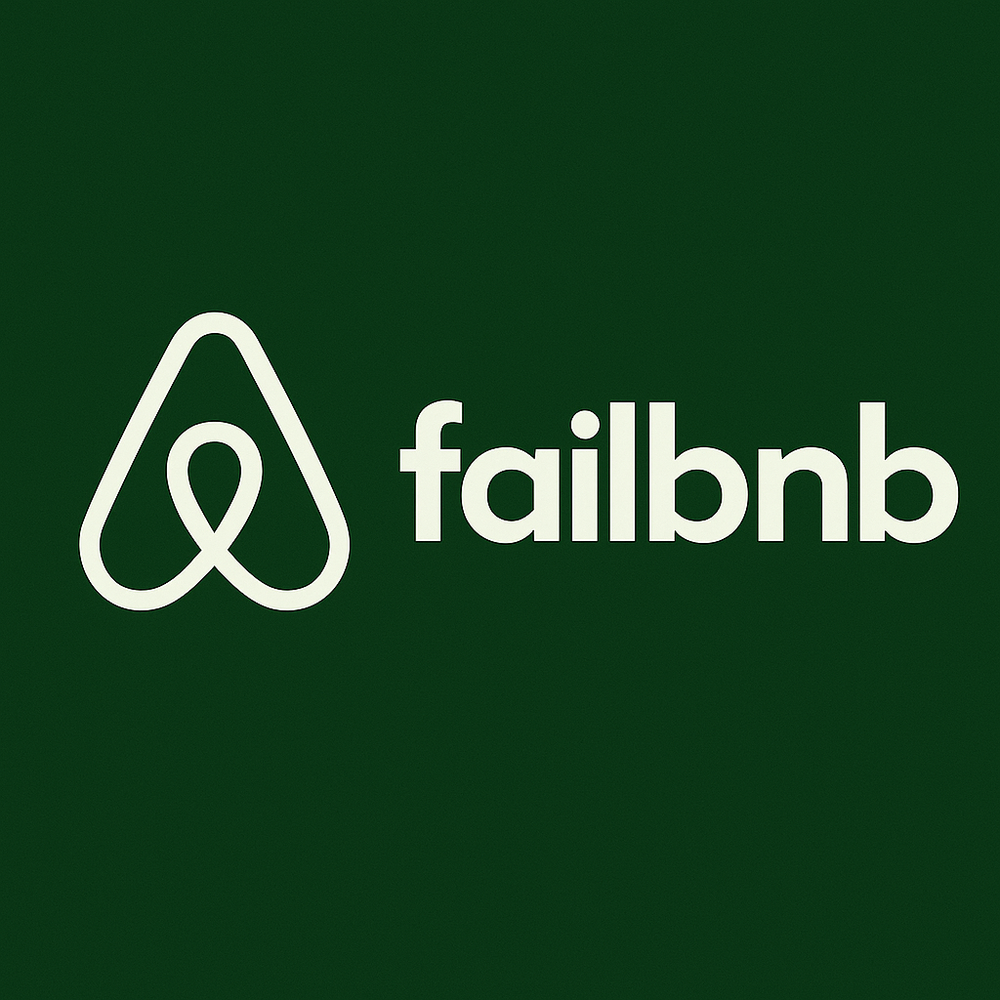

# FailBnB

Proyecto personal — aplicación full stack inspirada en Airbnb.

🔗 [Ver demo en vivo](https://failbnb.netlify.app)

---

## Stack

**Frontend:** React 19 + TypeScript, Vite, React Router DOM, Tailwind CSS, Axios  
**Backend:** Node.js + Express 5, MySQL, JWT, bcrypt, Cloudinary  
**Testing:** Jest + Supertest  
**DevOps:** GitHub Actions (CI), Railway, Netlify, Docker  

---

## Funcionalidades

- Registro y login con autenticación JWT
- Roles diferenciados: huésped y anfitrión
- Listado y filtrado de propiedades
- Galería de imágenes con almacenamiento en Cloudinary
- Sistema de reservas con validación de fechas y disponibilidad
- Panel de perfil con gestión de reservas y anuncios propios
- CRUD completo de propiedades con control de ownership

---

## Autor

**Enzo Dellape** — [GitHub](https://github.com/EnzoDellp)
